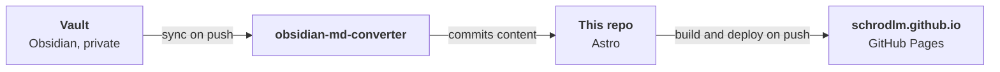

<h1 align="center">schrodlm.github.io</h1>

<p align="center">
  My notes, posts, projects and whatever I want to write,<br>
  created in Obsidian and published as a garden of ASCII flowers.
</p>

<p align="center">
  <a href="https://github.com/schrodlm/schrodlm.github.io/actions/workflows/deploy.yml"></a>
</p>

<p align="center">
  <a href="https://schrodlm.github.io">schrodlm.github.io</a>
</p>

## What's on it

- **[Posts](https://schrodlm.github.io/posts/)**: thoughts I want to share,
  each growing its own flower in the garden on the home page
- **[Notes](https://schrodlm.github.io/notes/)**: short computer-science notes
  I made during my studies, with a [map](https://schrodlm.github.io/graph/) of
  how they link
- **[Projects](https://schrodlm.github.io/projects/)**: write-ups of things I
  built, with the devlogs of their working sessions
- **[Courses](https://schrodlm.github.io/courses/)**: reviews of the
  university courses I took at FIT ČVUT and MFF UK
- **[About](https://schrodlm.github.io/about/)** and my
  **[CV](https://schrodlm.github.io/cv/)**, also as a PDF

## How it works

Nothing on the site is written in this repository. The content lives in a
private Obsidian vault. Every push there runs a sync that converts the
Obsidian markdown into normalized markdown with
[obsidian-md-converter](https://github.com/schrodlm/obsidian-md-converter) and
commits the result into `src/content/` here. Every push to `main` builds the
site with [Astro](https://astro.build) and deploys it to GitHub Pages.



This repository owns how the site looks: the pages, the drawings, the styles
and the CV's layout. The vault owns what it says.

## Running it locally

It needs the Node.js version in `.nvmrc`:

```bash
npm ci
npm run dev             # serve with live reload at http://localhost:4321
npm run build:fixtures  # build from the invented sample content
npm run build           # build from src/content/, as the deploy does
```

The checks, the screenshot tests, the CV PDF and previewing with real content
are in [docs/development.md](docs/development.md).

## Documentation

| | |
|---|---|
| [docs/architecture.md](docs/architecture.md) | The three repositories, the sync, the parts of the site, and the deploy |
| [docs/development.md](docs/development.md) | Running and testing the site, the CV PDF, the preview, deploying |
| [docs/front-matter.md](docs/front-matter.md) | Every front-matter field each collection takes |
| [CONTEXT.md](CONTEXT.md) | The glossary: vault, sync, note, stub, intro and the rest |
| [docs/adr/](docs/adr/) | Decisions that shape the site |

Work is planned in [the issues](https://github.com/schrodlm/schrodlm.github.io/issues),
ordered by [milestones](https://github.com/schrodlm/schrodlm.github.io/milestones).
