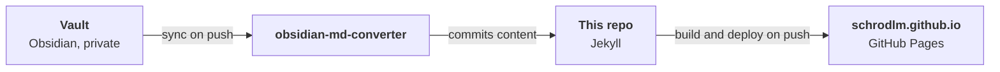

<h1 align="center">schrodlm.github.io</h1>

<p align="center">
  My notes, posts, projects and whatever I want to write,<br>
  created in Obsidian and automatically published as a static site.
</p>

<p align="center">
  <a href="https://github.com/schrodlm/schrodlm.github.io/actions/workflows/pages.yml"></a>
</p>

<p align="center">
  <a href="https://schrodlm.github.io">schrodlm.github.io</a>
</p>

## What's on it

- **[Notes](https://schrodlm.github.io/notes/)**: short computer-science notes I made during my university studies
- **[Posts](https://schrodlm.github.io/)**: basically blog posts, just thoughts I want to share
- **[Projects](https://schrodlm.github.io/projects.html)**: write-ups of things I built
- **[Courses](https://schrodlm.github.io/courses/)**: reviews of the
  university courses I took at FIT ČVUT and MFF UK
- **[CV](https://schrodlm.github.io/cv.html)**: CV for marketing purposes

## How it works

Nothing on the site is written in this repository. The content lives in a
private Obsidian vault. Every push there runs a sync that converts the
Obsidian markdown with
[obsidian-md-converter](https://github.com/schrodlm/obsidian-md-converter) and
commits the result here. Every push here builds the site with Jekyll and
deploys it to GitHub Pages.



This repository owns how the site looks: layouts, styles, scripts and the CV.
The vault owns what it says.

## Documentation

| | |
|---|---|
| [docs/architecture.md](docs/architecture.md) | The three repositories, the sync, what the converter translates, and the deploy |
| [docs/development.md](docs/development.md) | Running the site locally, rendering the CV PDF, deploying |
| [CONTEXT.md](CONTEXT.md) | The glossary: vault, sync, note, stub, intro and the rest |
| [docs/adr/](docs/adr/) | Decisions that shape the site |

## Running it locally

```bash
bundle install
bundle exec jekyll serve --livereload
```

The CV PDF and its other details are in [docs/development.md](docs/development.md).

## Where it is heading

The site is being revived. The plan is the
[Revive schrodlm.github.io](https://github.com/schrodlm/schrodlm.github.io/issues/1)
map, and its order follows the
[milestones](https://github.com/schrodlm/schrodlm.github.io/milestones):

- **0 · Foundations**: this knowledge base and the issue tracking
- **1 · Design language**: the garden, where every post and note grows its own ASCII flower
- **2 · Notes**, with an interactive graph view
- **3 · About**
- **4 · Courses**
- **5 · Projects**
