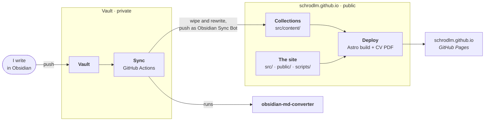

# Architecture

The site is the last stage of a pipeline that spans three repositories. Content
is written in my private Obsidian vault, translated by a converter, and pushed
here, where every push to `main` builds and deploys the site. The words used
here are defined in the [glossary](../CONTEXT.md), and the decisions behind the
design are the [ADRs](adr/).

## The three repositories

| Repository | Visibility | Job |
|---|---|---|
| The vault | private | Everything is written here. Every push to it runs a **sync**. |
| [`schrodlm/obsidian-md-converter`](https://github.com/schrodlm/obsidian-md-converter) | public | The **converter**, a Python CLI that turns Obsidian markdown into **normalized markdown**. |
| `schrodlm/schrodlm.github.io` (this one) | public | The Astro site. Every push to `main` **deploys** it to [schrodlm.github.io](https://schrodlm.github.io). |

## The sync

A workflow in the vault runs the converter over the vault's published folders,
writes the result into `src/content/` of this repo, and pushes it to `main` as
*Obsidian Sync Bot*. It pushes with a deploy key, which can write to this repo
and nothing else and never expires, so the push triggers this repo's deploy,
as a push with `GITHUB_TOKEN` would not.

Three consequences shape all work here:

- **The collections belong to the vault.** Each sync rewrites `src/content/`
  whole, so an edit made to it in this repo lasts only until the next sync.
  Fix content in the vault ([ADR 1](adr/0001-content-is-written-in-the-vault.md)).
- **The site asks nothing of the converter.** It accepts only normalized
  markdown, as the converter's published specification defines it
  ([ADR 4](adr/0004-the-site-accepts-only-normalized-markdown.md)), and
  decides only how to render it. How the vault's Obsidian markdown becomes
  normalized markdown is the converter's business.
- **A page the site can't accept fails the deploy.** Every collection has a
  strict schema ([front-matter.md](front-matter.md)); a field in the wrong
  form fails the build and names the file, and the site that is live stays
  as it was.

## The site

The site is built with Astro
([ADR 2](adr/0002-the-site-is-built-with-astro.md)). It reads normalized
markdown from one content folder, `src/content/`: a folder per collection,
and the images the content embeds in `assets/img/`, which the site serves at
`/assets/img/`.

| Part | What it does |
|---|---|
| `astro.config.mjs` | The site's configuration, with the base path from `SITE_BASE` and the markdown pipeline. |
| `src/lib/base-path.ts` | Puts the base path in front of the content's site-absolute links, when there is one. |
| `src/lib/markdown/` | Renders normalized markdown in the house style: section headings with their trailing vines, callouts, math, figures, tables, task lists and links to **stubs**, as Sätteri plugins. |
| `src/components/Prose.astro` | Wraps a page's rendered markdown in the prose styles, `src/styles/prose.css`. |
| `src/pages/notes/`, `src/pages/posts/` | Each **note** at `/notes/<slug>/` and each **post** at `/posts/<slug>/`, laid out by `src/layouts/NoteOrPost.astro` with the page's **flower** and **specimen card**, and the lists at `/notes/` and `/posts/`. A note in a folder keeps the folder in its address, `/notes/<folder>/<slug>/`. |
| `src/pages/index.astro` | The home page: the **garden** of the posts, drawn by `src/components/Garden.astro` and laid out by `src/lib/life/garden.ts`, then my **intro**, the recent posts and the projects in progress. |
| `src/pages/herbarium/` | The **herbarium** at `/herbarium/`: the specimen card of every post and note that has its flower, in the order of their Latin names. |
| `src/lib/pages.ts` | Where a note or post lives, what its page says of it, and the order of each list. |
| `src/lib/graph.ts` | The link graph of the notes, worked out from their rendered HTML at build time: each note's links out, links in and the notes two steps away. |
| `src/lib/neighbourhood.ts`, `src/components/Neighbourhood.astro` | Lay out and draw a note's **neighbourhood** in braille, at the end of its page, with its captions as links. |
| `src/lib/graph-view.ts`, `src/components/GardenMap.astro`, `src/pages/graph/` | Lay out the whole **garden map** at build time, deterministically, and draw it in braille at `/graph/`, every note a link and every vine a layer brought up on hover by CSS alone. |
| `src/pages/feed.xml.ts` | The RSS feed of the posts at `/feed.xml`, written by `src/lib/feed.ts`. |
| `src/lib/content-images.ts` | Serves the content's images at `/assets/img/`, from the dev server and in the build. |
| `src/pages/courses/` | The **courses home** at `/courses/` and each reviewed course at `/courses/<slug>/`. |
| `src/pages/universities/` | Each **university page** at `/universities/<slug>/`, under its building's plate. |
| `src/lib/courses.ts` | What the course pages work out from the front matter: a course's name without its code, its **meters**, and the order of the lists. |
| `src/pages/projects/`, `src/pages/devlogs/` | The projects list at `/projects/`, each project's page at `/projects/<slug>/`, and each devlog at `/devlogs/<slug>/`. |
| `src/lib/projects.ts`, `src/lib/devlog.ts` | A project's milestone stages, sessions and **field journal**; a devlog's rendered HTML cut into its sections. |
| `src/lib/session-trail.ts` | Lays out and draws a devlog's **session trail**. |
| `src/pages/cv/` | The **CV** at `/cv/`, rendered from the one note in `cv/`; `src/styles/cv.css` holds its screen and print styles. |
| `src/lib/lamplit-desk.ts` | Draws the CV's plate, frame by frame, for its animation and for its still. |
| `src/pages/showcase/clascii/`, `src/scripts/clascii.ts` | The **showcase** of my ASCII art library, clascii, at `/showcase/clascii/`: it runs in its **pond**, with every control of its demo. The library's build is vendored in `public/vendor/clascii/` and loaded only there. |
| `src/lib/clascii/` | What that page works out without a browser: the settings from its controls, the ring the new art spreads in, and the jungle at night around it. |
| `scripts/print-cv-pdf.mjs` | Prints `/cv/` from the built site to `cv/cv.pdf`, beside the page. |
| `scripts/preview.sh` | Builds the preview from the vault and publishes it. |
| `.github/workflows/deploy.yml` | The deploy. |
| `.github/workflows/astro-ci.yml` | The checks. |

## The deploy

`.github/workflows/deploy.yml` runs on every push to `main`, the sync's
included, and on manual dispatch. It builds the site from `src/content/`,
prints the CV PDF beside the CV page with Playwright, and deploys the result
to GitHub Pages. The PDF exists only in the deployed site, never in the repo.

`.github/workflows/astro-ci.yml` runs the type check, the unit tests and the
screenshot tests, all over the invented sample content, on every pull request
into `main` and every push to it.

## The preview

The **preview** shows a branch's site with real content at `/site-preview/`.
It is published by hand from its own repository, `schrodlm/site-preview`, so
the live site is untouched until the branch is merged.
