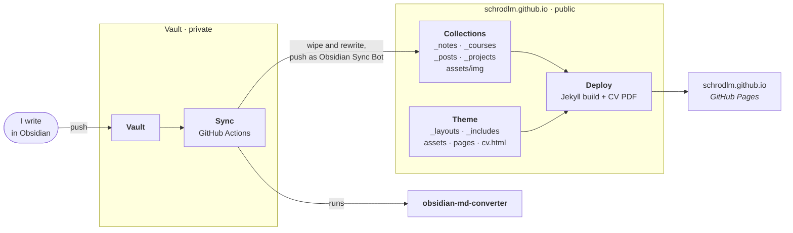

# Architecture

The site is the last stage of a pipeline that spans three repositories. Content
is written in my private Obsidian vault, translated by a converter, and pushed
here, where every push builds and deploys the site. The words used here are
defined in the [glossary](../CONTEXT.md), and the decisions behind the design
are the [ADRs](adr/).

## The three repositories

| Repository | Visibility | Job |
|---|---|---|
| The vault | private | Everything is written here. Every push to it runs a **sync**. |
| [`schrodlm/obsidian-md-converter`](https://github.com/schrodlm/obsidian-md-converter) | public | The **converter**, a Python CLI that turns Obsidian markdown into Jekyll markdown. |
| `schrodlm/schrodlm.github.io` (this one) | public | The Jekyll site. Every push to `main` **deploys** it to [schrodlm.github.io](https://schrodlm.github.io). |

## The sync

A workflow in the vault runs the converter over the vault's published folders,
with this repo checked out as its output, and pushes the result to `main` as
*Obsidian Sync Bot*. It pushes with an access token rather than
`GITHUB_TOKEN`, so the push triggers this repo's deploy.

Three consequences shape all work here:

- **The collections belong to the vault.** Each sync empties `_notes/`,
  `_posts/`, `_projects/` and `_courses/` and writes them again, so an edit
  made to them in this repo lasts only until the next sync. Fix content in the
  vault, or fix how the converter writes it.
- **Images only accumulate.** The converter copies the images a note embeds
  into `assets/img/` and never deletes one.
- **One bad note blocks the whole sync.** A missing image stops the converter,
  and nothing is pushed.

### What the converter translates

| Obsidian | On the site |
|---|---|
| `[[Note]]`, `[[Note\|text]]` | A link to `/<collection>/<slug>.html`. When the target is not published, just the text. |
| `[[Note#Heading]]` | Left as plain text, heading included. Heading links are not resolved. |
| `[[Note\|text]]` inside a table, written `\|` | The link is lost. |
| `![[image.png\|alt\|200x100]]` | `{:width=…}`, and the image is copied. |
| `` | The image is copied but the path stays relative, so it breaks under `/notes/`. |
| `$…$`, `$$…$$` | Passed through and rendered by KaTeX, on note pages only. |
| `> [!note] Title` callouts | Passed through as plain quotes, with the `[!note]` marker visible. |
| Dataview blocks | Passed through as code blocks. |
| Wikilinks inside code blocks | Rewritten, because code is not protected. |

## The site

The site is Jekyll on the [minima](https://github.com/jekyll/minima) theme,
with these parts overridden or added:

| Part | What it does |
|---|---|
| `_config.yml` | Declares the `notes`, `courses` and `projects` collections, and the navigation in `header_pages`. |
| `_layouts/note.html` | A note: its tags, the **connected notes** list (`assets/js/note-graph.js`), and KaTeX math, which no other layout loads. |
| `_layouts/post.html` | minima's post layout, plus the project the post belongs to. |
| `_layouts/project.html` | A project, plus its posts. |
| `_layouts/course.html` | A course with its ratings. |
| `_includes/header.html` | minima's header with an active-page marker and a GitHub icon. |
| `notes.html`, `courses.html`, `projects.html` | The section pages that list each collection, each with its **intro** if it has one. |
| `about.html`, `index.markdown`, `404.html` | The About page, the home page (minima's post list), and the 404 page. |
| `cv.html` | The **CV**, written as semantic HTML. `assets/main.scss` holds both its screen and its print styles. |
| `scripts/render-cv-pdf.mjs` | Prints `/cv.html` from the built site to a PDF with Playwright. |

## The deploy

`.github/workflows/pages.yml` runs on every push to `main` and on manual
dispatch. It builds the site with Jekyll, renders the CV PDF into the built
site with Playwright, and deploys the result to GitHub Pages. The PDF exists
only in the deployed site, never in the repo or in a plain local build.
